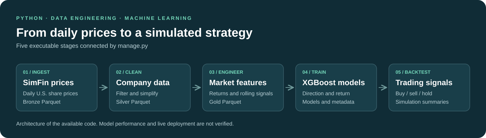

# Stock Market ML Pipeline

A collaborative Python project connecting daily U.S. stock prices to an ETL pipeline, XGBoost models, and an interactive Streamlit trading simulator.

**The app now opens with a working demo:** explore clearly labeled synthetic prices and models without an API key. A separate Live Analysis page connects to real SimFin data.

The engineering focus is the handoff from raw market data to consistent model features, saved models, and a browser interface for exploring signals and simulated strategies.

**[Executive summary](docs/reports/executive-summary.pdf)** · **[Project credits](CREDITS.md)** · **[Assessment feedback](docs/feedback-response.md)** · **[AI usage log](AI_USAGE_LOG.md)**



## Project overview

| Component | What it does |
| --- | --- |
| Ingestion and cleaning | Downloads SimFin company metadata/daily prices and creates company-specific Parquet datasets. |
| Feature engineering | Builds returns, volatility, momentum, 5/10/20-day moving-average ratios, volume features, interactions, and next-day training targets. |
| Machine learning | Trains XGBoost classification and regression models using a final 20% row holdout and five-fold time-series cross-validation. |
| Offline backtesting | Converts predictions into buy/sell/hold actions and simulates cash, holdings, and portfolio values. |
| Demo dashboard | Runs immediately with reproducible synthetic data, compact XGBoost models, price overlays, trade markers, portfolio comparison, fees, and export. |
| Live Analysis | Fetches daily prices on request and adds price/volume charts, dated model signals, strategy controls, and a simulated portfolio comparison. |
| Backtest Explorer | Reads saved offline results with company/range selection, return charts, trade filters, and CSV export. |

**Tools:** Python 3.11, SimFin, Polars, pandas, XGBoost, scikit-learn, PyArrow, Streamlit, python-dotenv, and TOML configuration.

The configured companies are Amazon, Microsoft, Apple, AAON, and Allstate. Selection and ETL paths are in [src/config.toml](src/config.toml).

## Results and feedback improvements

The original assessment supplied by the project owner was **90/100**. It awarded full marks to the API wrapper and ML model, and identified a feature-engineering bug, verbose errors, limited charts/interactivity, a missing deployment link, and a missing AI usage log.

The local revision corrects the moving-average windows, shares features between training and inference, simplifies ETL errors, adds interactive charts and controls, and includes an honest [AI usage log](AI_USAGE_LOG.md). See the [feedback response](docs/feedback-response.md) for each criterion and remaining gaps. These changes have not been regraded.

**Models must be retrained after the feature correction.** Historical fitted models were trained with the previous moving-average behavior. They are archived locally and omitted from the proposed publication tree. New model metadata carries a feature version; inference rejects models that predate the fix. Market charts remain usable without fitted models.

No performance results from corrected, retrained models are available. Synthetic checks verify software behavior, not predictive accuracy or profitability.

## Demo and deployment status

**[Open the live demo](https://stock-market-ml-ishashah-slky.onrender.com/)** — deployed on Render using the Free-plan configuration in `render.yaml`. The service may take about a minute to wake after inactivity. See the [deployment guide](docs/deployment.md).

The default dashboard is a functional walkthrough, not a screenshot or a set of fabricated project results. It creates synthetic daily prices for five illustrative company labels and fits small classification/regression models on an earlier portion of that synthetic history. Displayed signals use later observations separated from training by a one-row gap. Data provenance is shown in the UI and exported logs. Demo models stay in memory and never replace real-company artifacts.

## Run locally

Use **Python 3.11** and run commands from the repository root. The pipeline's configuration/data paths are relative to that directory.

```bash
git clone https://github.com/ishashahwork/python-ii-group-assignment.git
cd python-ii-group-assignment
python3.11 -m venv .venv
source .venv/bin/activate
python -m pip install -r requirements.txt
python -m streamlit run src/Home.py
```

On Windows PowerShell, use `py -3.11 -m venv .venv` and `.\.venv\Scripts\Activate.ps1`.

**No key is needed for the home dashboard.** For real SimFin data, copy `.env.example` to `.env` and set `API_KEY` to your own key. Cloud hosting can use private Streamlit Secrets instead; see the deployment guide. Do not commit the file. Downloads and the live page require network access and suitable SimFin data access. If XGBoost reports a missing OpenMP runtime on macOS, install it with `brew install libomp`.

To generate real-data offline artifacts, configure your SimFin key, then run:

```bash
python manage.py --help
python manage.py --stage all
```

The offline pipeline completes without starting a web server. Launch the multipage app separately:

```bash
python -m streamlit run src/Home.py
```

`python manage.py --stage app` launches the same app. Open the local URL Streamlit prints. Live Analysis fetches data only after **Load analysis** is submitted; chart and strategy controls reuse loaded data. The saved-results explorer shows an empty state until a backtest exists.

For individual pipeline stages, run these in order:

```bash
python manage.py --stage ingestion
python manage.py --stage cleaning
python manage.py --stage feature_engineering
python manage.py --stage model_training
python manage.py --stage trading_logic
```

Later stages require earlier artifacts. Training searches 40 parameter candidates across five folds per model/company and can take substantial time. After the feature fix, regenerate features, retrain both models, and regenerate backtests before using results. If bronze/silver data is missing, run the full pipeline instead.

## Verification

```bash
python -m unittest discover -s tests -v
```

The checks cover moving-average arithmetic, training/live feature parity, date alignment, the newest inference row, missing inputs, old-model rejection, dashboard filtering, and API-request reuse. Streamlit pages are exercised with AppTest and mocked market/model inputs.

Python 3.11 dependency installation, CLI help, 22 regression/UI checks, and a synthetic five-stage smoke run passed locally with an OpenMP runtime. The localhost server and health check returned HTTP 200. The Render build succeeded, the deployment is live, and its public home and health endpoints returned HTTP 200. Interactive browser review and real SimFin access were not completed; corrected-model performance remains untested. See [publication notes](docs/publication-notes.md).

## Limitations

- The offline pipeline assumes chronological input and does not explicitly sort by date. Offline backtesting still uses a fixed row offset rather than dates, which can misalign rows after missing-data removal. The live path now preserves dates through feature generation.
- Next-day targets use zero-gap time-series cross-validation. Split-boundary target overlap and holdout independence require review before interpreting scores.
- Simulations use same-row closing prices. The home demo supports a fixed fee per executed trade; the original live/offline flows default to zero fees, and all flows omit slippage. Live-requested dates can overlap model training, so the live simulator is not an independent holdout evaluation.
- Direct dependencies are pinned to the verified Python 3.11 versions. Transitive dependencies are not fully locked; the Render Linux cloud build succeeded.

This is an educational modeling and simulation project; it does not execute trades.

## Repository guide

```text
manage.py                         Pipeline/app CLI
requirements.txt                  Verified direct Python dependency versions
packages.txt                      Linux OpenMP dependency for hosting
src/Home.py                       Runnable demo dashboard and page entry point
src/dashboard.py                  Interactive charts, controls, and project context
src/demo.py                       Synthetic data and in-memory demo models
src/PySimFin.py                    API wrapper, live features, predictions, simulation
src/pages/Live_Analysis.py         Daily-price charts and strategy controls
src/pages/Backtest_Explorer.py     Saved offline-result charts and exports
src/pages/documentation.py        In-app project documentation
src/config.toml                   Companies, tickers, output paths
src/data_ingestion.py              Bronze datasets
src/data_cleaning.py               Silver datasets
src/feature_engineering.py         Shared features and model-version guard
src/model_training.py              Classification/regression training
src/trading_logic.py               Offline backtesting
tests/                            Offline regression and UI checks
docs/reports/executive-summary.pdf Original supplied report
docs/                             Module docs, feedback, provenance, architecture
.misc/                            Historical exploratory notebooks, outputs cleared
CREDITS.md                        Evidence-backed collaborator attribution
AI_USAGE_LOG.md                    Verified assistance; original records unavailable
```

Generated data, models, and backtests stay under ignored `ETL/` paths by default. Do not publish credentials or the ignored local archive. The `.misc` notebooks are historical explorations, not the final entry point.

## History and credits

The initial portfolio repository contained an older snapshot. The later `main` source (`858523a`, March 23, 2026) and the separate `part2` history were recovered from [nachimoreno's repository](https://github.com/nachimoreno/python-ii-group-assignment). The 39 original commits across available branches remain preserved: 28 by nachimoreno and 11 by ishashahwork. See [credits](CREDITS.md) for recorded contributions and the remaining team-roster gap.

No project license was supplied; collaborators should agree on reuse terms before one is added.
